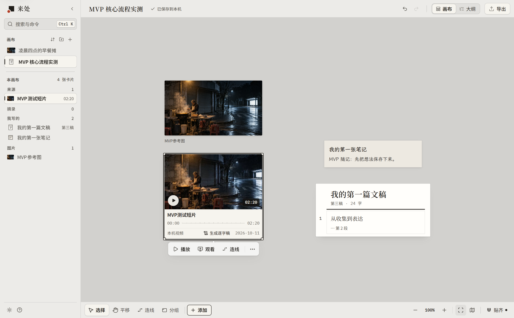
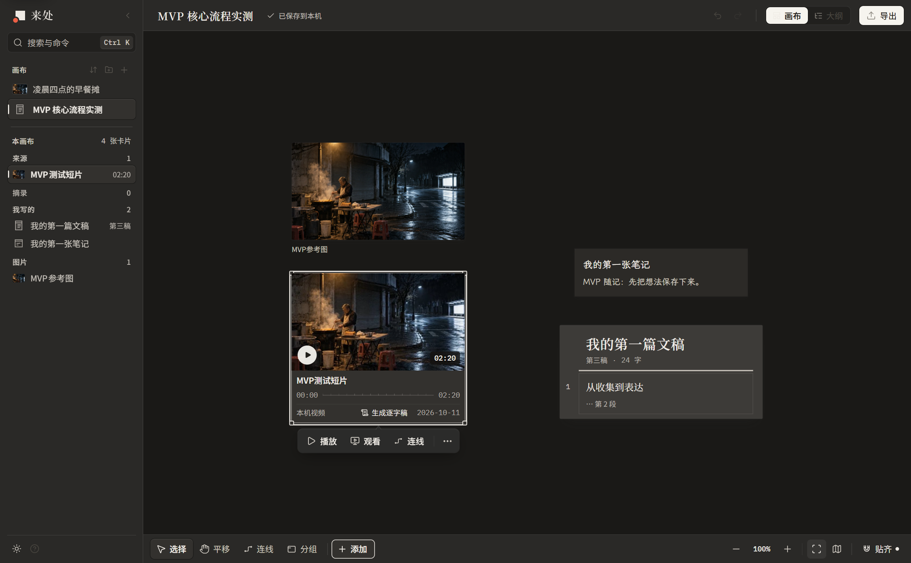

# 来处 whence

[English](README.en.md)

来处是给文字工作者、视频博主和创意工作者的本地画布：摘录留下出处，写作时能回到原文或视频时间点，没有账号，也没有云同步。



1. **打开示例画布。** 在欢迎页打开“我写文章”“我做视频”或“我做创意”。
2. **从卡片摘录并看到出处。** 在文字阅读面板或视频逐字稿中选中内容，使用“摘录到画布”；摘录保留原文或视频时间，卡片上能看到来源。
3. **在文稿里回到原文或视频时间点。** 从文稿中的引用或“本稿来源”回到资料；视频定位到对应时间。

## 用它做什么

[开始使用](docs/GETTING_STARTED.md) · [更新记录](CHANGELOG.md)

当前版本为 **MVP 0.1.0**。应用界面为**简体中文**；中英文文档介绍的是同一个中文界面产品。

| 创作方式 | 在画布上完成的事 |
| --- | --- |
| 写文章 | 收集资料、摘录原文、记录自己的理解，写文稿并保存版本。 |
| 做视频 | 整理视频与逐字稿，按时间点摘录，把素材组织成脚本。 |
| 做创意 | 摆放图片与笔记，用连线和分组整理参考，形成灵感板。 |

核心功能包括笔记、文稿与版本、图片和视频资料、来源摘录、连线与分组，以及画布保存和导出。导出既可以用于继续编辑，也可以用于交付文稿；两者包含的内容不同，详见[保存与导出](docs/GETTING_STARTED.md#保存与导出)。

欢迎页提供“我写文章”“我做视频”“我做创意”三块示例画布，也可以从空白画布开始。示例逐字稿属于演示内容，不代表实际识别结果。

<details>
<summary>查看深色画布</summary>



</details>

## 从源码运行

准备 **Node.js 24 LTS** 及随附的 npm。取得并解压源码后，在包含 `package.json` 的仓库根目录打开终端，依次运行：

```sh
npm ci
npm run build
npm start
```

开发模式与测试也从根目录运行：

```sh
npm run dev
npm test
```

Windows 11 已有实际运行验证；macOS 和 Linux 暂未验证。这里提供的是源码运行方式，构建命令不等同于生成签名安装包。安装步骤和第一块画布的操作见[开始使用](docs/GETTING_STARTED.md)。

## 尚未在新机器验收

- 视频链接下载和自动语音转写是可选高级流程，需要额外准备 Python 3.12、`yt-dlp`、`faster-whisper`、FFmpeg、ffprobe 与本地模型。基础画布使用不要求安装这些工具。
- 高级流程尚未在全新机器上完成验证。视频站点的登录要求、访问限制和链接状态都会影响下载，不保证全部站点或链接可用。

## 本地使用与 MVP 边界

- 内容保存在本机，不需要账户。当前没有云同步或多人协作。英语译成中文是可选能力，只在桌面版配置了接口密钥后才会请求外部接口，见[使用指南](docs/GETTING_STARTED.md#可选把英语译成中文)。
- 本地保存不等于独立备份。请关注保存状态，定期导出画布，并确认导出的素材完整。
- 桌面版再次启动会回到已经打开的窗口。只读只发生在同一来源的第二个页面，例如两个浏览器标签打开同一工作区。便携画布文件有容量限制，大视频应使用桌面版的“另存完整画布目录”。

具体容量和使用限制见[使用指南](docs/GETTING_STARTED.md#mvp-限制)。

## 源码布局

```text
package.json       根目录命令与依赖
studio/
  src/             界面与画布逻辑
  native/          本机服务
  public/          静态资源
  tests/           测试
  scripts/         启动、构建与检查脚本
electron/          桌面端与媒体处理支持
shared/            只有类型
docs/              使用文档与截图
```

代码中仍会看到 `field` 标识和 `.field.json` 文件名；这些是保留的数据兼容标识，产品名称为来处 whence。

## 许可

项目源码采用 [MIT 许可证](LICENSE)。第三方字体采用 SIL Open Font License（OFL），保留各字体的版权及许可证声明；它们不因随项目分发而改为 MIT。其他第三方依赖遵循各自的许可证。详见[第三方声明](studio/THIRD_PARTY_NOTICES.txt)与[素材来源](docs/ASSETS.md)。
